<a href="https://omaralatas.com">
  <picture>
    <source media="(max-width: 600px) and (prefers-color-scheme: dark)" srcset="assets/boot-narrow-dark.svg">
    <source media="(max-width: 600px)" srcset="assets/boot-narrow-light.svg">
    <source media="(prefers-color-scheme: dark)" srcset="assets/boot-dark.svg">
    
  </picture>
</a>

<p align="center">
  <samp>
    <a href="https://omaralatas.com" title="My site">omaralatas.com</a> ·
    <a href="https://omaralatas.com/brain" title="The map of my agent fleet">brain</a> ·
    <a href="https://omaralatas.com/stack" title="Every tool I use, with one line each">stack</a> ·
    <a href="https://www.linkedin.com/in/omaralatas" title="LinkedIn">linkedin</a>
  </samp>
</p>

```text
OMAR_OS · power-on self-test

[ ok ] core ...... digital plumber
[ ok ] handle .... Remixer
[ ok ] before .... esports caster
[ ok ] speaks .... EN · ID · AR
[ ok ] COO ....... Eterna Indonesia
[ ok ] product ... Merdeka.AI
[ ok ] fleet ..... 139 agents
[ ok ] floors .... ten departments
[ ok ] map ....... 683 nodes
[ ok ] gates ..... fail closed
[ ok ] code ...... mostly private
```

I am, at heart, a digital plumber. I connect things that do not talk to each other.

My first build was a Minecraft plugin, in Java, for a server I ran myself. The tools have changed. The instinct has not.

By day I run operations and technology at Eterna Indonesia. I also lead the product on Merdeka.AI, the CRM SunPower's sales organization runs on: over $1B of work, 33,000+ projects, 46 states. The team builds it. I decide what gets built and in what order.

This page is the other half: what I run, how it is wired, and the rules I hold to.

## <samp>[ ok ] fleet</samp>

I direct 139 agents in ten departments. I set the work. I review what ships.

```text
engineering · devops · product · qa
research · ops · design · marketing
security · data
```

<details>
<summary><samp>what each department does</samp></summary>

<br>

- <samp>engineering</samp> · An approved plan in, a diff that reads like the codebase out.
- <samp>devops</samp> · Keeps everything I run still running tomorrow. Nearly every step is safe to run a second time.
- <samp>product</samp> · Turns what somebody said in a meeting into a spec and a plan, so I stop being the bottleneck.
- <samp>qa</samp> · Stops me calling anything done too early. No claim of mine passes without the output that proves it.
- <samp>research</samp> · Reads the real docs before I recite my memory of them.
- <samp>ops</samp> · Routes, records, tracks and closes the loops I would drop.
- <samp>design</samp> · A direction before the first component exists, then an audit of what shipped.
- <samp>marketing</samp> · Writes and positions what ships, without a studio or a crew.
- <samp>security</samp> · Every byte I ship passes this gate first, and it fails closed.
- <samp>data</samp> · The read only path from my question to a number I am willing to put in front of a board.

</details>

Each agent follows a written skill, not a loose prompt. Agents that write code get their own worktree and their own file list. I do the merge, in order.

Every piece of work goes through the same loop:

```text
brainstorm → spec → plan → build
→ review → qa gate
→ deploy gate → ledger
```

A claim with no command output attached is an opinion. The whole floor is mapped at [omaralatas.com/brain](https://omaralatas.com/brain): 683 nodes, and every one is a real thing with a real record behind it.

## <samp>[ ok ] engine</samp>

The engine is the private repo my agent fleet runs on.

- <samp>hooks</samp> · A session starts from a true summary of the last one and ends by writing down what it did. When the router is unsure, it stays silent. A wrong route is worse than none.
- <samp>skills</samp> · An instruction I have typed twice becomes a skill, installed on every machine. The prompt is the bug. The skill is the fix.
- <samp>generators</samp> · The workspace map is written from disk and live settings, never by hand. Generated, not asserted.
- <samp>provisioning</samp> · Setup scripts for macOS and Windows that mirror each other. Every step checks before it acts, so running it twice is safe.
- <samp>guards</samp> · Secret scanners, a pre-push gate and encrypted backups. A check that runs after a leak is a report, not a gate.
- <samp>sync</samp> · My machines are equal and GitHub is truth. Work that exists on one disk is work that does not exist yet.

<samp>shell · node · python · powershell</samp>

## <samp>[ ok ] deck</samp>

[omaralatas.com](https://omaralatas.com) is built as a command deck: one HUD, one particle world and a palette on <kbd>Cmd</kbd> + <kbd>K</kbd>.

- A Next.js static export with React, TypeScript, Tailwind CSS and three.js. No server, no API routes, no middleware.
- The live parts run on one small Cloudflare Worker: a feed on a cron, a visitor counter and a PostHog relay, kept in one SQLite Durable Object.
- The sound has no audio files. Oscillators make it when it plays.
- The build fails if a text colour misses the contrast floor or the copy breaks its own rules.
- The brain is compiled, not drawn. Reviewed sources and a denylist go in, JSON comes out, with no network. If a locked name would ship, the run aborts and writes nothing. A clean scan over nothing scanned is a failure, not a pass.

Open the palette and type `run mainline`.

## <samp>[ ok ] bench</samp>

Small tools I built for myself. Both are private for now.

- **GILT** · An amber CRT tray app in Rust and Tauri. Live currency rates and world time on one hotkey. Tauri over Electron, for size.
- **MTG Brain** · Every Magic: The Gathering Commander card, ruling and rule in one SQLite file. Python standard library only, no API keys. Cited answers, offline.

## <samp>[ ok ] stack</samp>

What I use every week, not what I have read about. The full list, with one line on each tool, is at [omaralatas.com/stack](https://omaralatas.com/stack).

- <samp>lang</samp> · TypeScript · JavaScript · Python · Bash · PowerShell · SQL · Rust
- <samp>front</samp> · Next.js · React · Vite · Tailwind CSS · three.js · GSAP · Lenis · Zustand · Tauri
- <samp>edge</samp> · Cloudflare Workers · Durable Objects · Wrangler
- <samp>data</samp> · PostgreSQL · Supabase · MySQL · MongoDB · SQLite · PostHog
- <samp>agents</samp> · Claude Code · Model Context Protocol · claude-mem
- <samp>ship</samp> · Git · GitHub CLI · GitHub Actions · Docker · Playwright · Lighthouse

```text
> rules loaded
  understand before acting
  verify before claiming done
  never delete quietly
  secrets are placeholders
  static by default
> ready_
```

<sub>Remixer was the name I cast under for Garena Free Fire. You get no second take on a live world final. That is where I learned to communicate.</sub>
