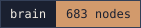
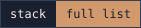
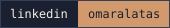

<a href="https://omaralatas.com">
  <picture>
    <source media="(max-width: 600px) and (prefers-color-scheme: dark)" srcset="assets/fab-narrow-dark.svg">
    <source media="(max-width: 600px)" srcset="assets/fab-narrow-light.svg">
    <source media="(prefers-color-scheme: dark)" srcset="assets/fab-dark.svg">
    
  </picture>
</a>

<picture>
  <source media="(prefers-color-scheme: dark)" srcset="assets/typing-dark.svg">
  
</picture>

I run operations and technology at Eterna Indonesia. I lead the product on Merdeka.AI, SunPower's CRM of record for its EPC network. It has tracked over $1B of work. The team builds it. I decide what gets built.

- **The engine** · the private repo my agent fleet runs on: hooks, skills, guards
- **omaralatas.com** · a Next.js static export, live parts on one Cloudflare Worker
- **GILT** · an amber CRT tray app in Rust and Tauri

<picture>
  <source media="(max-width: 600px) and (prefers-color-scheme: dark)" srcset="assets/stack-narrow-dark.svg">
  <source media="(max-width: 600px)" srcset="assets/stack-narrow-light.svg">
  <source media="(prefers-color-scheme: dark)" srcset="assets/stack-dark.svg">
  
</picture>

I direct 166 agents in ten departments and review what ships. The whole floor is mapped at [omaralatas.com/brain](https://omaralatas.com/brain).

  
  
  
  

